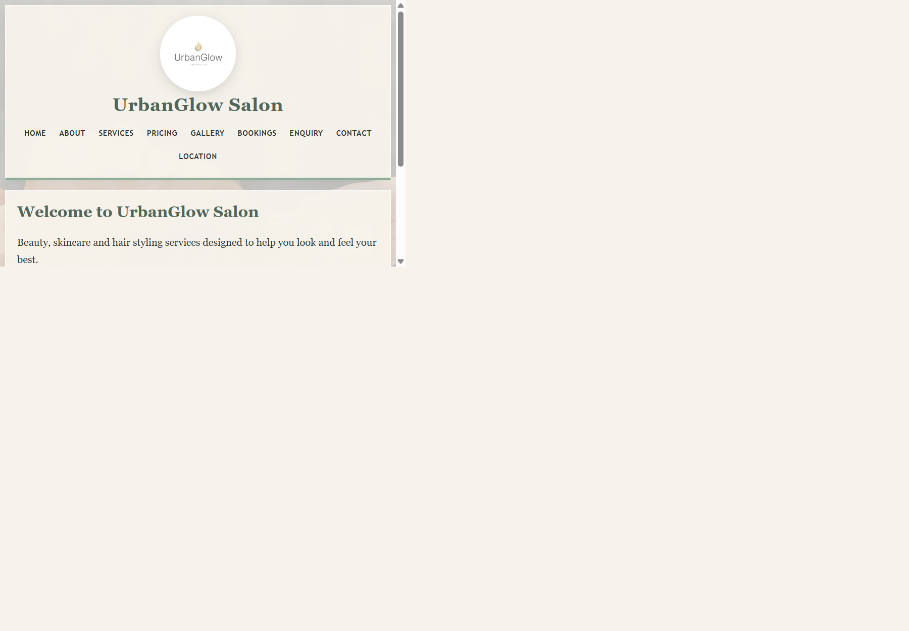
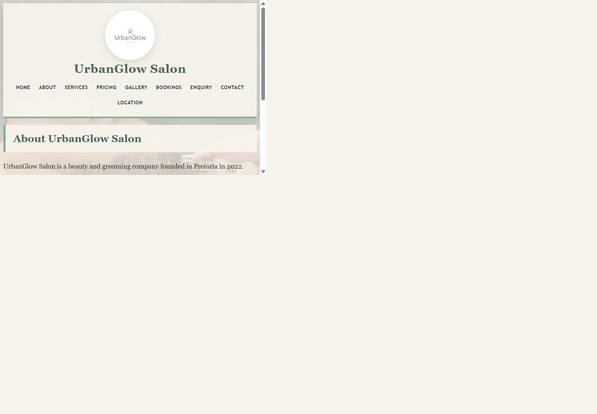
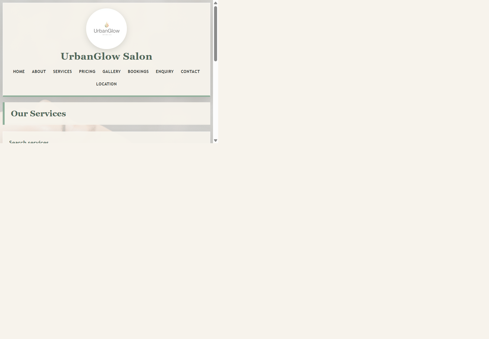
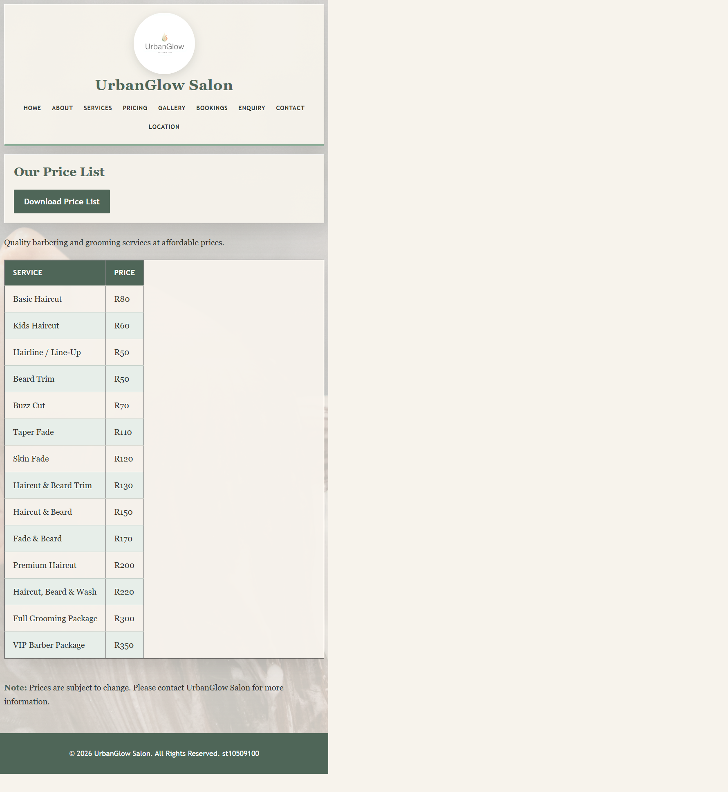
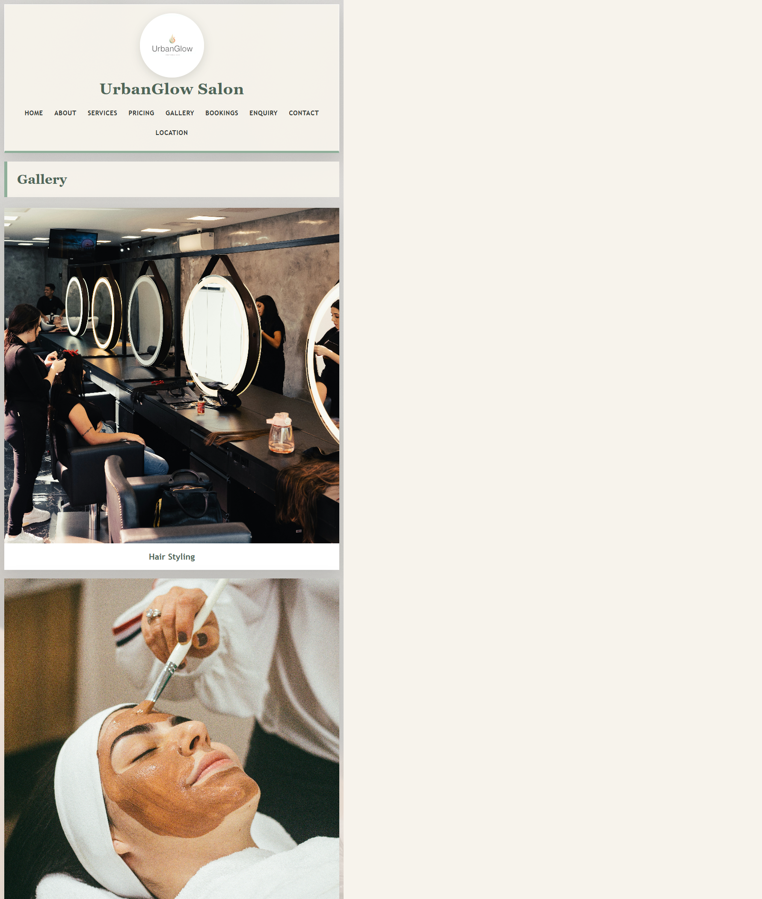
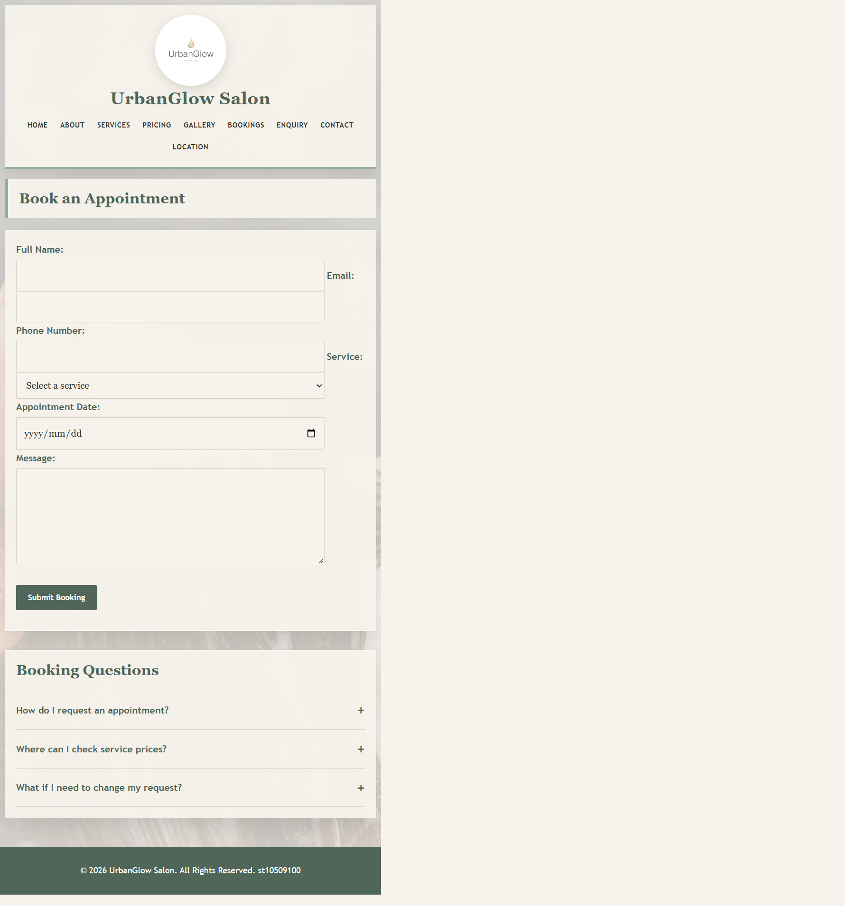
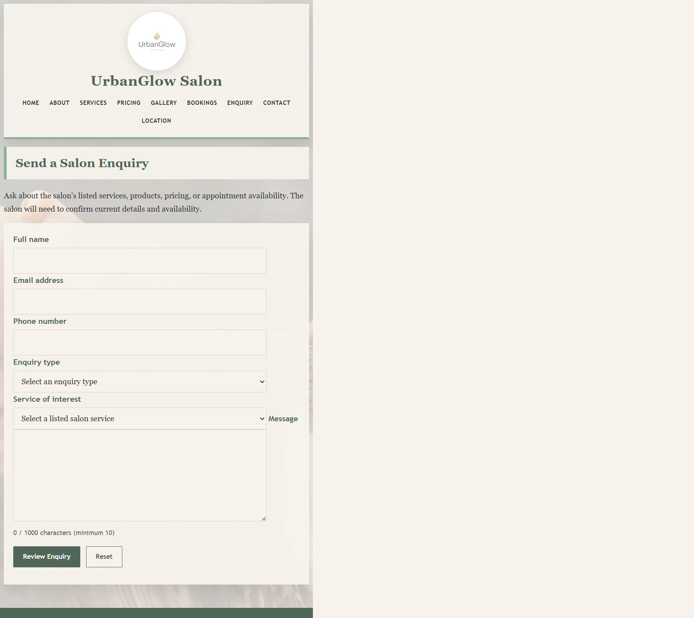
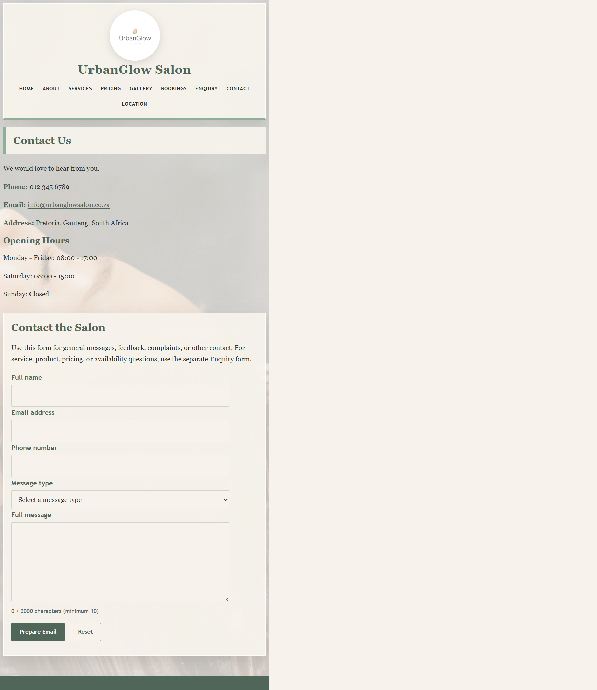
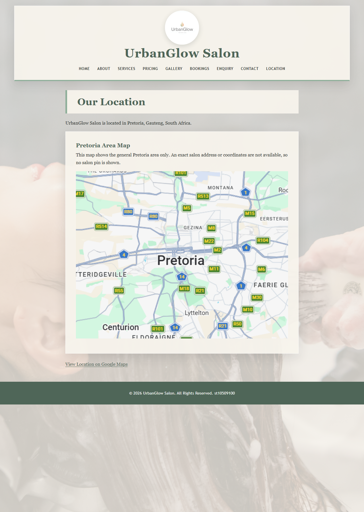

# UrbanGlow Salon

## Project Overview

UrbanGlow Salon is a responsive multi-page website developed for the WEDE5020 Web Development Introduction POE. It uses HTML, CSS, and vanilla JavaScript to present salon and grooming information through separate pages, shared navigation, local images, forms, tables, and interactive features. The website is designed for current and prospective salon clients who want to learn about services, review prices and images, request an appointment, find contact information, and view the general Pretoria area.

The website uses nine dedicated HTML pages with a consistent header, UGS logo, navigation menu, content area, and footer. Each page focuses on a specific area of the salon's information rather than placing all content on one long scrolling page.

## Project Purpose

The purpose of the project is to provide UrbanGlow Salon with a clear online presence and a practical information resource for its clients. The website communicates the salon's services, pricing, visual portfolio, booking process, contact details, and general Pretoria area.

The separate page structure supports straightforward browsing. Visitors can move directly from the navigation menu to the Home, About, Services, Pricing, Gallery, Bookings, Enquiry, Contact, or Location page. The website also provides separate appointment, enquiry, and contact forms, a downloadable price-list image, a gallery of salon-related images, and an interactive general-area map with a static image fallback on the Location page.

## Technologies Used

- **HTML5:** Structures the nine pages, navigation, forms, pricing table, gallery, dialogs, and map region.
- **CSS3:** Provides the shared layout, sage-green and cream colour palette, responsive styling, focus states, and transitions in `css/style.css`.
- **Vanilla JavaScript (ES modules):** Implements the accordion, tabs, modal, lightbox, service search and sorting, booking validation, and map setup. `js/main.js` initializes shared page features; the Gallery and Location pages load their page-specific modules.
- **Leaflet 1.9.4:** Provides the interactive general-area map on the Location page. Leaflet is loaded from unpkg; map tiles and the city-level geocoding request use OpenStreetMap services.
- **Local image assets:** Images in `images/` provide the logo, background, price-list download, gallery, and static map fallback.

The website does not use a JavaScript framework, package manager, or CSS framework.

## Website Pages

| Page | File | Purpose |
|---|---|---|
| Home | `index.html` | Introduces UrbanGlow Salon and provides a call-to-action link to the booking page. |
| About | `about.html` | Explains the salon's background, aims, services, and professional environment. |
| Services | `services.html` | Presents the existing Hair Styling, Beauty Services, Skincare, and Grooming descriptions in keyboard-accessible tabs with search and A-Z sorting. |
| Pricing | `pricing.html` | Provides the grooming price table and downloadable price-list image. The image is difficult to read; the HTML table remains available. |
| Gallery | `gallery.html` | Displays four existing salon-related images with captions and an interactive lightbox. |
| Bookings | `bookings.html` | Provides an appointment form with client-side validation and a booking FAQ accordion. |
| Enquiry | `enquiry.html` | Provides a separate form for service, product, pricing, and appointment-availability questions, with existing service choices and type-specific guidance. |
| Contact | `contact.html` | Provides telephone, email, address, opening hours, and a separate general/feedback/complaint contact form. |
| Location | `location.html` | Displays a general Pretoria-area Leaflet map, a static map fallback, and a Google Maps search link. The project does not provide verified salon coordinates or a street address. |

## Website Screenshots

The following full-page screenshots show the nine website pages as rendered at the integrated browser's available `642 x 422` viewport. Select a thumbnail to open the full-size image.

### Home
[](screenshots/index.png)

### About
[](screenshots/about.png)

### Services
[](screenshots/services.png)

### Pricing
[](screenshots/pricing.png)

### Gallery
[](screenshots/gallery.png)

### Bookings
[](screenshots/bookings.png)

### Enquiry
[](screenshots/enquiry.png)

### Contact
[](screenshots/contact.png)

### Location
[](screenshots/location.png)

## Features

The following features are implemented in the current project:

- **Consistent navigation:** All nine pages include links to the complete set of website pages.
- **UrbanGlow Salon UGS logo:** The existing `images/UGS Logo design.jpg` image is used in the shared header and links back to `index.html`.
- **Service tabs and directory:** The Services page displays the existing service descriptions in accessible tabs. Visitors can search names, sort alphabetically, and receive a no-results message. The feature reads existing page content and does not add services.
- **Pricing information:** The Pricing page includes a grooming price table and a downloadable price-list image.
- **Gallery lightbox:** The four existing gallery images open in an image viewer with previous/next buttons, keyboard arrow navigation, Escape and outside-click closing, and background scroll locking.
- **Booking form:** The Bookings page includes required name, email, telephone, service, and date fields plus an optional message. Client-side validation displays field errors and a success confirmation. The form does not submit to a backend.
- **Booking FAQ accordion:** Visitors can expand and collapse booking questions using accessible buttons.
- **Booking-information modal:** The Home page provides a dialog with close-button, Escape, and outside-click closing, focus return, and background scroll locking.
- **Enquiry and Contact forms:** These are separate from the appointment booking form. Enquiry handles service/product/pricing/availability questions; Contact handles general enquiries, feedback, complaints, and other messages.
- **Email draft and optional AJAX:** With no endpoint configured, a valid Enquiry or Contact submission produces a pre-filled draft for `info@urbanglowsalon.co.za` and states that the website has not sent it. Set each form's `data-ajax-endpoint` only after configuring a real service endpoint; AJAX delivery has not yet been tested.
- **Enquiry form:** `enquiry.html` asks for name, email, phone, enquiry type, one existing service, and a 10–1000 character message. HTML5 constraints remain available without JavaScript; with JavaScript enabled, individual validation errors and a live count are shown. Type-specific guidance uses existing service/pricing information, including existing price examples, and explains that product details and appointment availability need salon confirmation.
- **Contact form:** `contact.html` asks for name, email, phone, message type, and a 10–2000 character message. HTML5 constraints remain available without JavaScript; its separate JavaScript validator compiles valid values into a pre-filled email draft addressed to the existing organization email. It is separate from service/product/pricing/availability enquiries.
- **Submission and AJAX:** Both forms have mailto actions as fallbacks. No backend or submission service is currently configured, so valid form data is not sent by the site. AJAX uses `fetch()` only when a real HTTPS endpoint is supplied in a form's `data-ajax-endpoint` attribute and only reports acceptance after a successful HTTP response.
- **Existing appointment booking:** `bookings.html` remains a separate appointment-request form with its original client-side validation and booking FAQ; it has not been replaced by either new form.
- **Interactive map:** The Location page uses Leaflet and OpenStreetMap tiles, zoom controls, and attribution to display the general Pretoria area. Because no verified street address or salon coordinates exist in the project, no salon pin is shown. `images/Map.png` remains as a fallback.
- **Search-engine metadata:** All nine pages have unique titles and descriptions, Open Graph metadata, a consistent heading hierarchy, and descriptive alternative text for meaningful images.
- **Responsive design:** The stylesheet includes media queries, flexible widths, responsive images, wrapped navigation, and mobile adjustments.
- **Interactive navigation and buttons:** Navigation links use file-based destinations, while the Home call-to-action and form buttons are styled as interactive controls.
- **CSS hover and focus effects:** The stylesheet implements `:hover` and `:focus-visible` states for links and navigation, hover/focus states for buttons, and focus states for form controls.
- **Background image:** The existing `images/UrbanGlow background.jpg` is used as the website background through the shared stylesheet.

## Design and Colour Scheme

The website uses a restrained salon-oriented palette defined in `css/style.css`:

- **Sage Green:** `#8FAF9A`
- **Dark Sage:** `#4F6658`
- **Warm Cream:** `#F7F3EC`
- **Charcoal:** `#2F3430`
- **Blush:** `#D9A6A6`
- **White:** `#FFFFFF`

Sage green is used for borders, accents, and supporting interface details. Dark sage and charcoal provide readable heading, navigation, label, and body-text colours. Warm cream is used for content backgrounds, form fields, and the background-image overlay, creating a calm and polished salon presentation. Blush is used sparingly for navigation indicators, button hover states, and form focus outlines. White is used where light text is needed against dark sage backgrounds, such as buttons, table headings, and the footer.

## Responsive Design

The website adapts to desktop, tablet, and mobile screen sizes through CSS media queries in `css/style.css`.

- At widths up to `768px`, the background changes to a mobile-friendly scroll attachment and top-centered position.
- At widths up to `768px`, the header, main content, and content panels use narrower widths and reduced spacing.
- Navigation links wrap onto multiple lines and use smaller gaps and text sizes.
- Gallery figures change to full-width blocks on smaller screens.
- Tables become horizontally scrollable within their own area when their content requires more width.
- At widths up to `420px`, the main heading, navigation links, and table cell padding are reduced for small phone screens.
- Images use `max-width: 100%` and automatic height scaling so they remain within their containers.
- Form controls use flexible widths limited by their available content area.
- The body uses `overflow-x: hidden` to prevent unwanted horizontal page scrolling.

## Images and Assets

The following exact filenames are present in the project's `images/` folder:

- `UGS Logo design.jpg` — UGS UrbanGlow Salon logo used in the header on all pages.
- `UrbanGlow background.jpg` — website background image referenced by `css/style.css`.
- `UGS Price list.jpg` — downloadable price-list image used on `pricing.html`.
- `UGS Hair Stylist.jpg` — hair-styling image used on the Gallery page.
- `UGS Services.jpg` — barber haircut image used on the Gallery page.
- `UGS Barber.jpg` — barber-service image used on the Gallery page.
- `UGS Saloon Shop.jpg` — salon-shop image used on the Gallery page.
- `Map.png` — location map image used on `location.html`.

The project uses local image paths with the exact spelling, capitalisation, spaces, and file extensions shown above. Gallery alt text and captions describe the visible image content. The price-list image is present but its text is largely unreadable; it has not been replaced because no verified replacement was available. The readable HTML pricing table remains on `pricing.html`. Image-source documentation is listed in References.

## File Structure

```text
UrbanGlow Salon/
├── index.html
├── about.html
├── services.html
├── pricing.html
├── gallery.html
├── bookings.html
├── enquiry.html
├── contact.html
├── location.html
├── CHANGELOG.md
├── README.md
├── css/
│   └── style.css
├── images/
│   ├── Map.png
│   ├── UGS Barber.jpg
│   ├── UGS Hair Stylist.jpg
│   ├── UGS Logo design.jpg
│   ├── UGS Price list.jpg
│   ├── UGS Saloon Shop.jpg
│   ├── UGS Services.jpg
│   └── UrbanGlow background.jpg
└── js/
	├── main.js
	├── components/
	│   ├── accordion-tabs.js
	│   ├── gallery-lightbox.js
	│   └── modal.js
	└── features/
		├── animations.js
		├── booking-validation.js
		├── contact-form.js
		├── content-loader.js
		├── enquiry-form.js
		├── form-utils.js
		├── leaflet-map.js
		└── pricing-controls.js
```

`js/features/animations.js` and `js/features/pricing-controls.js` are placeholders and are not loaded by the pages. Existing CSS transitions provide hover and accordion/lightbox animation styling; pricing-table search or sorting is not implemented. The Services directory uses `content-loader.js` and the existing Services page panels.

## Navigation

The website uses separate HTML pages rather than one long scrolling page. The shared navigation appears in the header of every page and links to the following destinations:

- Home → `index.html`
- About → `about.html`
- Services → `services.html`
- Pricing → `pricing.html`
- Gallery → `gallery.html`
- Bookings → `bookings.html`
- Enquiry → `enquiry.html`
- Contact → `contact.html`
- Location → `location.html`

The Home page's **Book an Appointment** call-to-action links directly to `bookings.html`. The UGS logo also links to `index.html`.

## Accessibility and Usability

The current project includes the following accessibility and usability features:

- Images include alternative text, including the UGS logo, gallery images, and map image.
- Accordion and tab controls expose their state with ARIA attributes and support keyboard interaction.
- The modal and lightbox provide labeled controls, keyboard closing/navigation, and focus return.
- Booking validation connects field-level messages to controls and announces form feedback through a live status region.
- Enquiry and Contact fields use explicit labels, required/format/length constraints, associated field errors, and live status feedback. Reset buttons clear errors and messages.
- The map region is labeled for assistive technology and displays OpenStreetMap attribution.
- The page structure uses headings, navigation, sections, figures, captions, a form, a table, an address block, and a footer to organise information.
- Navigation labels clearly identify the destination pages.
- The external stylesheet provides readable typography and consistent spacing.
- Warm cream content areas are used behind the website content and over the background image.
- Dark sage and charcoal are used for text against the light content areas.
- Navigation links, buttons, and form controls have clear visual styling.
- `:focus-visible` and form `:focus` rules provide visible interaction feedback.
- Responsive layouts support desktop, tablet, and mobile screen widths.
- Images scale within their containers, and horizontal page scrolling is prevented on small screens.

The booking form includes labels associated with its controls through `for` and `id` attributes. Required fields retain the HTML `required` attribute and are checked by the client-side validator; Message is optional.

## Testing and Validation

The final Part 3 QA pass checked the original eight pages and their implemented interactions. The new Enquiry page and Contact form were tested separately afterwards. Results:

- All original eight pages loaded in the browser, and the Enquiry and Contact pages were opened for form testing. Shared navigation targets now include `enquiry.html` and were checked against existing page files.
- Browser viewport checks at `390 x 844`, `768 x 1024`, and `1366 x 900` found no horizontal overflow. All local page images loaded after the lightbox image was given a valid initial source.
- Services testing covered tab selection, keyboard navigation, search results, no-results feedback, A-Z sorting, and search combined with sorting.
- Booking testing covered FAQ expansion/collapse, empty submission, invalid name, email, phone and past date, plus valid submission and confirmation. The confirmation explicitly states that no request is sent to a backend.
- Enquiry testing covered empty/invalid fields, message minimum length, reset, all four enquiry-type responses, existing service selection, a pre-filled email draft, and the absence of AJAX calls while no endpoint is configured.
- Contact testing covered empty/invalid fields, message minimum length, feedback message type, reset behavior, and a pre-filled email draft to `info@urbanglowsalon.co.za`. It was confirmed that no message is sent and no AJAX call occurs without a configured endpoint.
- Home modal testing covered opening, scroll locking, close button, Escape, outside click, and focus return.
- Gallery testing covered the four images, captions and alt text, previous/next buttons, arrow keys, Escape, outside click, close button, scroll locking, and focus return.
- Location testing confirmed OpenStreetMap tiles and attribution, Zoom In/Zoom Out tile-level changes, and the existing image fallback when the geocoding request was deliberately blocked.
- Static checks confirmed unique page titles/descriptions, Open Graph fields, one `h1` per page, no skipped heading levels, image alt attributes, and resolving local asset references.
- VS Code reported no diagnostics errors for the original eight HTML pages, the new Enquiry page, the stylesheet, and all touched JavaScript files. `git diff --check` passed. No uncaught JavaScript exceptions were observed during browser page loads.

The deliberately blocked geocoding request produced an expected network error in the browser log; the fallback message and image displayed correctly. Browser background-tab throttling pauses CSS animation timelines, so accordion/lightbox final states were checked after completing the transition in the test harness rather than timing the animation visually.

## Known Limitations

- The Bookings form performs client-side validation and displays a confirmation but has no server or booking service to submit or store appointment requests.
- The Enquiry and Contact forms currently provide client-side validation and pre-filled `mailto:` drafts. They do not transmit or store form data without a configured submission service.
- AJAX form delivery is not active or verified. An endpoint must be created with a form provider, configured separately on both forms, and tested against the deployed origin before submissions can be described as delivered.
- `info@urbanglowsalon.co.za` is the address already listed in the project and used for the mailto drafts; mailbox ownership and delivery were not independently verified.
- No product catalogue or live appointment schedule is present, so those enquiry responses direct visitors to ask the salon rather than claiming unsupported information.
- The project contains only the general address `Pretoria, Gauteng, South Africa`, not a verified salon street address or coordinates. The Leaflet map therefore shows the general Pretoria area and intentionally has no salon marker.
- Leaflet is loaded from unpkg; city geocoding and map tiles use OpenStreetMap services. These map features require an internet connection. The local `images/Map.png` is the fallback.
- The downloadable `images/UGS Price list.jpg` is largely unreadable. The HTML pricing table is retained; the image should be replaced only when a verified readable price list is available.
- `js/features/animations.js` and `js/features/pricing-controls.js` are placeholders; there is no separate animation feature module or pricing-table search/sort feature.

## Form Submission Setup

No backend, API route, or form service endpoint is included in this project. The Enquiry and Contact forms currently set `action="mailto:info@urbanglowsalon.co.za"`; their JavaScript creates an email draft link and clearly says that the website has not sent the message. Opening the draft requires a configured email application, and the visitor must press Send.

For AJAX submission, a suitable hosted option is [Formspree](https://formspree.io/). Create a form endpoint for each workflow and verify that the plan supports browser-origin requests. Then put each real HTTPS endpoint in that form's `data-ajax-endpoint` attribute in `enquiry.html` and `contact.html`. The form scripts send `FormData` with `fetch()` and only report acceptance when the endpoint returns a successful HTTP response. Leave the attribute blank until the real endpoint has been created and tested. After configuration, test from the deployed site origin and confirm receipt in the service dashboard or destination inbox. The contact mailto draft remains available when no endpoint is configured.

## Running Locally

Use a local HTTP server so ES modules and the Leaflet integration load correctly. From the project root (`UrbanGlow Salon`), run:

```powershell
py -m http.server 8000
```

Then open `http://localhost:8000/index.html` in a browser. Stop the server with `Ctrl+C`. If the Python launcher is unavailable, use `python -m http.server 8000` or open `index.html` with the VS Code Live Server extension. An internet connection is needed for the Leaflet library, geocoding, and map tiles.

## Development and Feedback

The website was refined during development in response to feedback from Part 1. The improvements included restoring and expanding the external CSS presentation, establishing a consistent salon brand through the UGS logo and colour scheme, correcting local image paths, and changing the navigation from one long scrolling page to dedicated pages for each site purpose.

The shared header and footer were made consistent across the pages, while page-specific content was kept on its appropriate page. Responsive rules were added and checked for smaller devices, including navigation wrapping, scalable images, mobile spacing, flexible form controls, table handling, and prevention of unwanted horizontal scrolling.

## Changelog

### Part 2 Corrections

- Corrected the UGS logo path in all eight HTML pages to match the exact existing filename, `images/UGS Logo design.jpg`.
- Updated `pricing.html` to use the UrbanGlow Salon name consistently and replaced the invalid button-inside-link markup with a direct download link. The existing HTML pricing table was retained.
- Updated the four links in `gallery.html` to open their corresponding existing gallery images.
- Added `rel="noopener noreferrer"` to the external Google Maps link in `location.html`, which opens in a new tab.
- Inspected `images/UGS Price list.jpg`; its text is largely unreadable. The image was not replaced because no verified replacement was available. The readable HTML pricing table remains in `pricing.html`.
- **Files changed:** `index.html`, `about.html`, `services.html`, `pricing.html`, `gallery.html`, `bookings.html`, `contact.html`, and `location.html`. `images/UGS Price list.jpg` was inspected but left unchanged because no verified replacement was available.

### Part 3 JavaScript Structure and Features

- Added `enquiry.html` as a separate enquiry workflow for salon services, products, pricing, and appointment availability. It includes name, email, phone, enquiry type, an existing service selection, a 10–1000 character message, field-level validation, live character count, and Reset/Review Enquiry buttons. Responses use only existing service/pricing information; products and current availability are not invented.
- Improved `contact.html` with a separate contact workflow for general enquiries, feedback, complaints, or other messages. It includes name, email, phone, message type, a 10–2000 character message, validation, live character count, and Reset/Prepare Email buttons. Valid details are compiled into a pre-filled draft to `info@urbanglowsalon.co.za`.
- Added `form-utils.js` for shared client-side validation, feedback, message counts, mailto encoding, and guarded AJAX submission. `enquiry-form.js` and `contact-form.js` contain separate form behavior.
- Both new forms currently have a mailto `action` and blank `data-ajax-endpoint`. They do not send or store information through the website. `fetch()` runs only after a real HTTP(S) endpoint is configured, and success is reported only after a successful response. Formspree is documented as a suitable service option; its endpoint still must be created, added to both forms, and tested from the deployed site. The Contact mailto draft remains the fallback.
- Organized vanilla JavaScript as ES modules under `js/components/` and `js/features/`. `js/main.js` initializes shared features on the Home, Services, and Bookings pages; Gallery and Location load their page-specific modules once.
- Implemented the accessible FAQ accordion on `bookings.html` and keyboard-accessible service tabs on `services.html`.
- Added the Home booking-information dialog with a close button, Escape and outside-click closing, focus return, and background scroll locking.
- Added the Gallery lightbox using the four existing images, with previous/next buttons, keyboard arrow navigation, Escape/outside-click/close-button dismissal, responsive layout, and scroll locking. Updated the second gallery caption to match the barber image and gave the hidden lightbox image a valid existing initial source.
- Added Services search, alphabetical sorting, and no-results feedback. `js/features/content-loader.js` reads the existing service panel names and descriptions; no services or prices were invented.
- Added client-side booking validation in `js/features/booking-validation.js` for required fields, name, email, phone, service selection, and a non-past appointment date. Valid input displays a confirmation but is not transmitted because no booking backend exists.
- Added separate enquiry and contact forms. `enquiry.html` captures service/product/pricing/availability questions and gives accurate, type-specific guidance. `contact.html` captures general enquiries, feedback, complaints, or other messages and compiles a mailto email draft using `info@urbanglowsalon.co.za`.
- Added shared form validation and submission helpers in `js/features/form-utils.js`, with separate handlers in `js/features/enquiry-form.js` and `js/features/contact-form.js`. Both forms validate name, email, phone, required selections, and message length; AJAX remains inactive until a real endpoint is configured.
- Final compliance review added a native phone pattern to both new forms, added existing price examples to Pricing-enquiry guidance, and preserved a Contact/Enquiry email-draft fallback when a configured AJAX request fails. The simulated 503 test was only an error-path test, not a live endpoint test.
- Added a Leaflet/OpenStreetMap map on `location.html`, with zoom controls, attribution, city-level geocoding for Pretoria, and the existing image as a fallback. No exact salon pin is shown because the project has no verified coordinates.
- Added unique titles and descriptions, Open Graph metadata, heading checks, and descriptive image alt text across all eight pages.
- `js/features/animations.js` and `js/features/pricing-controls.js` remain placeholders. Pricing-table search/sorting and a separate animation module are not implemented.
- **Files:** all eight HTML pages for Part 2 corrections and SEO metadata; Part 3 feature files include `css/style.css`, `js/main.js`, `js/components/accordion-tabs.js`, `js/components/modal.js`, `js/components/gallery-lightbox.js`, `js/features/content-loader.js`, `js/features/booking-validation.js`, and `js/features/leaflet-map.js`. The price-list image was inspected but not changed.
- **Form files added/updated:** added `enquiry.html`, `js/features/form-utils.js`, `js/features/enquiry-form.js`, and `js/features/contact-form.js`; updated the original eight pages for Enquiry navigation, with the separate Contact form added to `contact.html`; updated `css/style.css` for the responsive form feedback.

### Verification Performed

- All eight pages were opened in a browser and checked for their titles and descriptions. Navigation targets and local image references were checked against files in the project.
- Responsive browser checks at `390 x 844`, `768 x 1024`, and `1366 x 900` for the original pages, plus a 360px Contact form check, found no horizontal overflow or broken local images.
- Browser checks covered service tabs/search/sorting/no-results and keyboard navigation; FAQ expansion/collapse; modal open and close paths; gallery image loading, buttons, keyboard navigation, and close paths; and booking validation with empty, invalid, and valid submissions.
- Enquiry and Contact browser tests blocked invalid submissions, checked individual errors and character length, confirmed reset behavior, verified all four type-specific Enquiry responses and the formatted Contact email draft, and confirmed `fetch()` was not called while endpoint configuration was blank.
- Both forms were rendered at a 360px viewport with no horizontal overflow. Mailto destinations and encoded subject/body content were inspected in the browser; opening/sending an email was not claimed as tested.
- AJAX endpoint delivery remains untested because no real endpoint is configured. No successful server-side submission is claimed.
- The Leaflet map loaded OpenStreetMap tiles and attribution; zoom controls changed tile zoom levels. Blocking the geocoding request produced the expected fallback message and displayed the existing map image.
- Static checks confirmed unique page titles/descriptions, Open Graph fields, one `h1` per page, no skipped heading levels, image alt attributes, and working internal links. VS Code reported no diagnostics errors for the HTML, CSS, or JavaScript files; `git diff --check` passed.
- The deliberate geocoding block produced a network error in the browser log as part of the fallback test. No uncaught JavaScript exceptions were observed during page loads.

## References

Google Maps (no date) *Google Maps*. Available at: https://www.google.com/maps/ (Accessed: 18 September 2026).

Unsplash (no date) *About Unsplash*. Available at: https://unsplash.com/about (Accessed: 18 September 2026).

Leaflet (no date) *Leaflet - an open-source JavaScript library for interactive maps*. Available at: https://leafletjs.com/.

OpenStreetMap contributors (no date) *Copyright and License*. Available at: https://www.openstreetmap.org/copyright.

The website does not use a CSS framework. Shared site styling is contained in `css/style.css`; the Location page loads Leaflet's stylesheet and library from unpkg.

## Author

- **Student Name:** Lesedi Ramorula
- **Student Number:** st10509100
- **Module:** WEDE5020 Web Development (Introduction)
